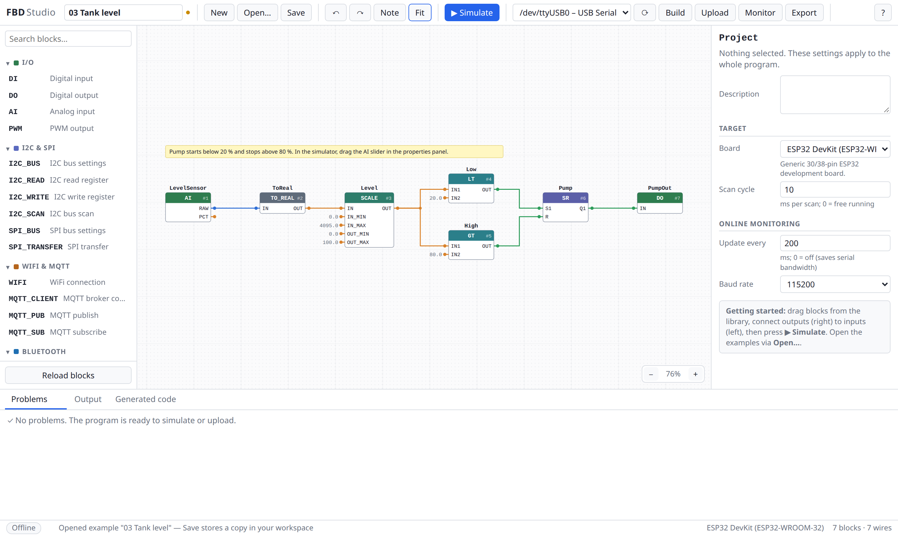
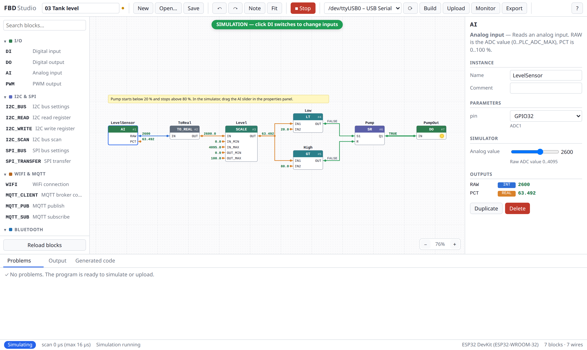
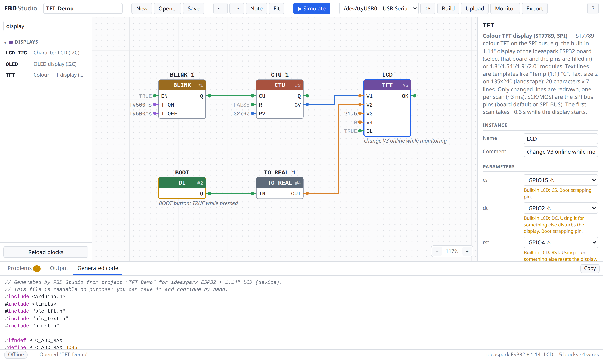

# FBD Studio

Graphical **function block diagram** programming for microcontrollers (ESP32
first, with STM32 and others planned). It is modelled on IEC 61131-3 PLC
programming and aimed at students, hobbyists and small industrial users.



- **PLC-style blocks:** AND/OR/XOR/NOT, SR/RS, R_TRIG/F_TRIG, TON/TOF/TP,
  CTU/CTD/CTUD, comparisons, arithmetic, SEL/MUX/LIMIT/MAX/MIN, type
  conversions, and DI/DO/AI/PWM I/O.
- **Control blocks:** PID (anti-windup, filtered derivative, bumpless manual
  mode), state feedback for LQR or pole-placement gains (with optional
  integral action), lead-lag, PT1/PT2 lags, integrator, differentiator, dead
  time, rate limiter/setpoint ramp, moving average, dead band, on/off control
  with hysteresis, and a time-proportioning output for relays and SSRs. They
  measure the actual time between scans, so they behave the same at any cycle
  time. With PT1, PT2 and DEADTIME you can also simulate a simple process inside
  the program and practise tuning without hardware.
- **Communication blocks** where the board supports them: I2C (register
  read/write, bus scan), SPI transfer, WiFi, MQTT publish/subscribe (Home
  Assistant, Node-RED, …) and Bluetooth: classic serial for Android/PC, or
  BLE (Nordic UART Service, optional pairing PIN) for iPhone and Android.
- **Sensors and displays:** BME280/BMP280, DS18B20 (several per pin), DHT11/22,
  I2C character LCDs (16x2, 20x4), SSD1306/SH1106 OLEDs and ST7789 colour TFTs
  (incl. the built-in display of the ideaspark ESP32 1.14" board). Display lines are
  templates like `Temp {1:1} °C`. All drivers work step by step, so a slow
  sensor never stalls the scan cycle. MQTT runs in a
  background task, so a slow network doesn't stall it either.
- **Scan cycle semantics:** a fixed cycle time, data-flow execution order (shown
  on every block), and feedback loops that use the previous scan's value.
- **Simulator:** runs the *same generated C++* on your PC. Toggle inputs, move
  analog sliders and watch values live, with no hardware needed.
- **Build & upload** through PlatformIO, then **monitor online** over USB
  serial. You can change setpoints and timer presets while the board runs.
- **Readable code:** export the generated PlatformIO project and continue in
  C++ if you need to.
- **Modelica export:** test the program against a model of the machine or
  process in OpenModelica (software in the loop). See
  [Testing with a plant model](#testing-with-a-plant-model-modelica).
- **Extensible:** your own blocks and boards are simple YAML files with C++
  snippets. See [docs/BLOCKS.md](docs/BLOCKS.md).

## Screenshots

**Simulation:** the program runs on your PC; values are shown live on every
wire, and the AI slider in the properties panel stands in for the level sensor.



**Display blocks and generated code:** a TFT text display on the ideaspark
ESP32 board (pins filled in from the board definition), with the C++ that
FBD Studio generates for it.



## Quick start

```bash
./setup.sh                 # once: creates .venv and installs everything (safe to re-run)
./run.sh                   # starts FBD Studio and opens http://127.0.0.1:8765/
```

On **Windows** use `setup.bat` and `run.bat` instead (double-clicking them
works too). The simulator needs `g++`; the setup script explains how to get
it via MSYS2 if it is missing.

The setup options are: `--platformio` (also install PlatformIO for real boards),
`--recreate` (rebuild the venv from scratch), `--no-dev` (skip test tools).
The run script works from any directory, runs the setup automatically if needed,
and passes options through, e.g. `./run.sh --port 9000 --no-browser`.

Requirements:

- Python 3.10+
- a C++ compiler (`g++` or `clang++`) for the simulator
- [PlatformIO](https://platformio.org/) (`pip install platformio`) to build
  for and upload to real boards. The first ESP32 build downloads the toolchain
  (several hundred MB).

Projects, your own blocks and build output live in a workspace folder
(default `~/FBDStudio`, change it with `--workspace`).

## Examples

Open them with **Open...**; saving stores a copy in your workspace. Everything
runs in the simulator, and the sensor, display and radio blocks also need the
hardware named. Unless noted, examples are for a generic ESP32 DevKit.

| Example | Shows |
|---|---|
| 01 Blink | BLINK, DO: the on-board LED |
| 02 Motor start-stop | RS latch, TON, CTU: a classic motor circuit |
| 03 Tank level | AI, SCALE, LT/GT, SR: pump control with hysteresis |
| 04 Logic gates | AND, XOR, NOT: two-hand safety control, two-way light switch |
| 05 Timers | TON, TOF, TP on one button |
| 06 Car park counter | CTUD up/down counter, SUB, LE |
| 07 PWM dimmer | AI potentiometer, LIMIT, SEL, PWM |
| 08 Thermostat | day/night setpoint (SEL), hysteresis with SUB/ADD/LT/GT/SR |
| 09 Weather station | BME280 sensor, 16x2 I2C LCD |
| 10 Freezer alarm | two DS18B20 probes on one pin, TON, OR, 128x64 OLED |
| 11 Greenhouse | DHT22, fan/frost control, MAX with a feedback wire |
| 12 WiFi and MQTT | WIFI, MQTT_CLIENT, MQTT_PUB/SUB (Home Assistant, Node-RED) |
| 13 Phone control over BLE | BLE_UART, BT_SEND/BT_RECV: iPhone and Android apps |
| 14 Bluetooth Classic serial | BT_SERIAL for Android and PCs, CTU reset from the phone |
| 15 I2C registers - MPU-6050 | I2C_SCAN, I2C_READ, I2C_WRITE with any I2C chip |
| 16 SPI thermocouple - MAX6675 | SPI_TRANSFER, DIV/MOD/TO_BOOL bit decoding |
| 17 ideaspark TFT display | TFT block on the ideaspark ESP32 board's built-in 1.14" LCD |
| 18 PID temperature control | DS18B20, PID, TPO pulses for a solid-state relay, manual mode |
| 19 PID tuning with a simulated plant | PID, RAMP, PT1 + DEADTIME as a simulated process |
| 20 State feedback - motor position | STATE_FB with LQR gains, simulated DC motor (PT1, INTEG) |

## Testing with a plant model (Modelica)

**Export… → Modelica package** turns the diagram into a Modelica package with a
`Controller` block. Put it into a model of your tank, conveyor or heating
system in [OpenModelica](https://openmodelica.org/) and check the control
behaviour before connecting real equipment.

- The block runs the **same C++ as the microcontroller**, once per scan cycle
  (`when sample(0, cycleTime)`). Timers count simulated time, so a 10-minute
  test runs in seconds.
- **Inputs and outputs:** DI → `BooleanInput` (the signal after *invert*),
  AI → `RealInput` in % of full scale (quantised like the real ADC),
  DO → `BooleanOutput`, PWM → `RealOutput` in %. Sensor values (BME280,
  DS18B20, DHT) become `RealInput`s, and MQTT/Bluetooth values become inputs
  and outputs. Bus, WiFi and display blocks report "OK/connected".
- **Parameters:** every unconnected input of the diagram (setpoints, timer
  presets, limits, …) is a parameter, so you can try other values without
  exporting again. TIME values are in seconds.
- The package contains a compiled library for your system
  (`Resources/Library/linux64` or `win64`) and the C++ source with a build script
  (`Resources/Source/build.sh` / `build.bat`) for other systems. Several
  exported controllers can be used in one model.
- `Example` in the package runs the controller with constant inputs: a quick
  check that everything loads.

Use it like this:

```modelica
model TankTest
  Real level(start = 50, fixed = true) "% full";
  TankLevel.Controller ctrl;   // exported from "03 Tank level"
equation
  ctrl.LevelSensor = level;
  der(level) = (if ctrl.PumpOut then 10 else 0) - 2;
end TankTest;
```

Simulated, the pump starts when the level falls to 20 % (t = 15 s) and stops
at 80 % (t = 22.5 s), just like the program on the board. Requirements:
OpenModelica with the Modelica Standard Library 4.x, and `g++`/`ar` on the
PC that exports (the same compiler the simulator uses).

## How it works

```
diagram (JSON) ─► compiler.py ─► main.cpp + plcrt.h ─┬─► PlatformIO ─► board ─┐
                  (types, pins,                     │                         │ serial line protocol
                   order, loops)                    └─► g++ + sim shim ─► PC  ┤ (values / online writes)
                                                                              ▼
                                                                web UI (live values on the diagram)
```

| path | what |
|---|---|
| `fbdstudio/library/blocks/*.yaml` | built-in block definitions |
| `fbdstudio/library/boards/*.yaml` | board definitions (pins and capabilities) |
| `fbdstudio/compiler.py` | validation, execution order, C++ generation |
| `fbdstudio/runtime/plcrt.h` | device runtime: scan timing, monitor protocol |
| `fbdstudio/runtime/sim/` | Arduino API emulation for the simulator |
| `fbdstudio/modelica.py`, `fbdstudio/runtime/model/` | Modelica export (package, library, Arduino shim with simulated time) |
| `fbdstudio/server.py` | FastAPI REST + WebSocket server |
| `fbdstudio/static/` | web UI (plain ES modules, no build step) |

## Tests

```bash
.venv/bin/pip install -e ".[dev]"
.venv/bin/python -m pytest
```

The tests compile every built-in block with every allowed data type
(`g++ -std=c++11`). They also run a simulated program end to end: they press
an input, check the timer delay and change a preset online. If OpenModelica
(`omc`) is installed, every example is also exported as a Modelica package
and simulated, including the tank example against a tank model.

## Status

Version 0.1. Tested on an ESP32 (ideaspark ESP32 with 1.14" LCD): upload via
PlatformIO, serial live monitor with online changes, BLE serial with PIN
pairing (Android), and the built-in TFT display. The I2C/SPI, WiFi/MQTT,
sensor (BME280, DS18B20, DHT) and other display blocks build for ESP32 and run
in the simulator, but have not been tried on real hardware yet.

## License

MIT, see [LICENSE](LICENSE).
